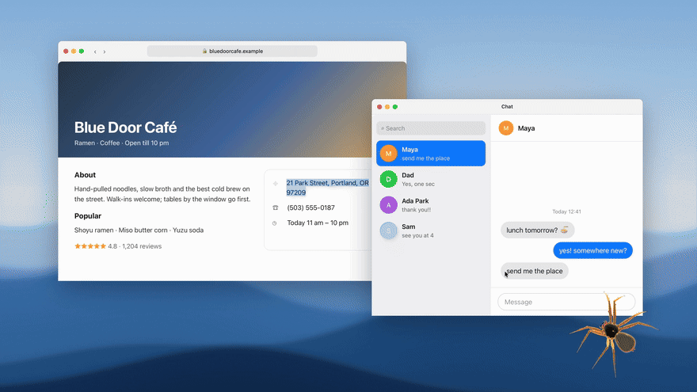

# SilkNest

**A clipboard manager for Mac with a spider. Everything stays on your Mac.**

[](https://github.com/shxwat/silknest/releases/latest)


[](LICENSE)


> [!IMPORTANT]
> **Your clipboard is yours.**
> - 🔒 **Stays on your Mac.** History, screenshots, text read from images and notes never leave it. No account, no cloud sync, no ads.
> - 🛡️ **Encrypted on disk.** AES-256-GCM with a key made on your Mac; owner-only and kept out of Time Machine.
> - 🙈 **Secrets are never saved.** Password-manager and concealed copies are never written to disk. API keys, tokens, card numbers and one-time codes (also inside screenshots) are masked, kept in memory only and gone after two minutes.
> - 🚫 **You decide what's caught.** Password managers are always skipped, and you can exclude any other app.
> - 🌐 **One network call only:** the update check to `silknest.app`. It sends nothing about you or your clipboard, and you can turn it off.
> - 🆓 **Free and open source** (GPL-3.0): read every line of what runs on your Mac.

A small 3D spider lives on your desktop. Copy anything — text, links, code, files, images, screenshots —
and it catches it, wraps it in silk and carries it to its nest in the corner. Press **⇧⌘Space** and the
Nest spreads out with everything you copied; pick something and it is pasted where you were typing.



## Features

- **Compact Nest** — opens in the middle of the screen you're looking at (about 60% of it), over
  full-screen apps too. Type to search, ↩ to paste, ⇧↩ to paste as plain text, 1–9 for the newest.
- **1000 items** — the web shows one page at a time; scroll or Page Up / Page Down for older ones.
  Pinned items come first and are never dropped.
- **Search inside screenshots** — text in images is read on your Mac (Apple Vision) and becomes
  searchable, together with text, links, domains, file names and the app you copied from.
- **Paste Stack** — queue several items and paste them in order: ⌃⌥V after each copy (or ⌘↩ in the
  Nest), then every ⌘V pastes the next one.
- **Secret protection** — API keys and tokens, private keys, card numbers and one-time codes are
  recognised in copied text *and inside screenshots*. They're kept in memory only, shown masked or
  blurred, and disappear after two minutes.
- **Exclude apps** — pick apps whose copies the spider ignores (Settings, or "Don't Catch from …" in
  the menu bar). Password managers are always skipped.
- **Silk Notes** — quick notes that hang from the top of your screen on silk threads (⌥N). Write a time
  ("in 20 min", "at 4 pm") for a reminder with Snooze and Done, use `[ ]` for checklists, right-click
  for more; notes are found by Nest search too.
- **A spider with moods** — it glows red on the hunt, turns silver-blue and looks away from secrets,
  follows your pointer, wiggles after a burst of copies and dozes on a thread when you leave it alone.
  Every animation respects Reduce Motion, and it rests at about 1% CPU.
- **Small extras** — transforms (UPPERCASE, Trim, One Line, Pretty JSON, URL Decode), drag items out to
  any app, drop files on the spider, uninstall from Settings.

## Shortcuts

| Shortcut | What it does |
|---|---|
| ⇧⌘Space | Open / close the Nest |
| ↩ / ⇧↩ | Paste the selected item / as plain text |
| 1 – 9 | Paste that item (with an empty search) |
| ⌘↩ | Add the selected item to the Paste Stack |
| ← → ↑ ↓, Tab | Move between items, open an item's card |
| Page Up / Page Down, scroll | Newer / older items |
| Esc | Close the card → clear the search → close the Nest |
| ⌃⌥V | Add your newest copy to the Paste Stack |
| ⌥N | New Silk Note |

All global shortcuts can be changed in Settings.

## Install

Requires a Mac with Apple silicon and macOS 14 Sonoma or later.

**Download** — get `SilkNest-<version>.dmg` from [GitHub Releases](https://github.com/shxwat/silknest/releases/latest)
(or [silknest.app](https://silknest.app)), open it and drag SilkNest to Applications.

**Homebrew**

```sh
brew trust shxwat/tap && brew install --cask shxwat/tap/silknest
```

**Terminal** — downloads the release from silknest.app, checks its SHA-256 and code signature, and
installs it into Applications:

```sh
curl -fsSL https://silknest.app/install.sh | sh
```

### First launch: "Open Anyway"

SilkNest is **not notarized by Apple yet**, so macOS blocks the first launch:

1. Open SilkNest once; macOS says it can't be checked. Click **Done**.
2. Open **System Settings → Privacy & Security**, scroll down and click **Open Anyway** next to SilkNest.
3. Confirm with your password. From then on it opens normally.

**Why not notarized?** Notarization requires a paid Apple Developer ID ($99 a year). SilkNest is a free
project and doesn't have one yet. Instead, releases are signed with a permanent self-signed
"SilkNest Signing" certificate (so macOS keeps your permissions across updates), every download has a
published SHA-256, and updates must carry a valid Ed25519 signature. Notarization is planned.

### 1-click paste (optional)

To paste straight into your app, SilkNest needs **Accessibility** (System Settings → Privacy & Security →
Accessibility). It is used only to press ⌘V for you; nothing you type or see is recorded. Without it,
choosing an item copies it and you press ⌘V yourself.

## Privacy and security

- Clipboard history, screenshots, text read from images and notes **never leave your Mac**.
- Stored encrypted (AES-256-GCM, a random key made on your Mac), owner-only, and excluded from Time
  Machine. Password-manager copies and detected secrets are never written to disk.
- The only network request is the update check to `silknest.app` (a small signed `version.json`, 20 s after
  launch, every 3 hours and on wake) and downloading an update. Nothing about you or your clipboard is sent;
  turn off automatic updates in Settings to stop it.
- Removing an item or clearing the history deletes its files; Settings → Uninstall removes everything.

Details: [SECURITY.md](SECURITY.md). Report vulnerabilities privately (GitHub → Security → Report a vulnerability).

## Build from source

```sh
git clone https://github.com/shxwat/silknest.git && cd silknest
./scripts/build-app.sh          # ad-hoc signed when you don't have the SilkNest certificate
open .build/SilkNest.app
./scripts/test-motion.sh        # checks
```

See [CONTRIBUTING.md](CONTRIBUTING.md) for signing, tests, developer modes and code style.

## License

[GPL-3.0](LICENSE) © SilkNest
